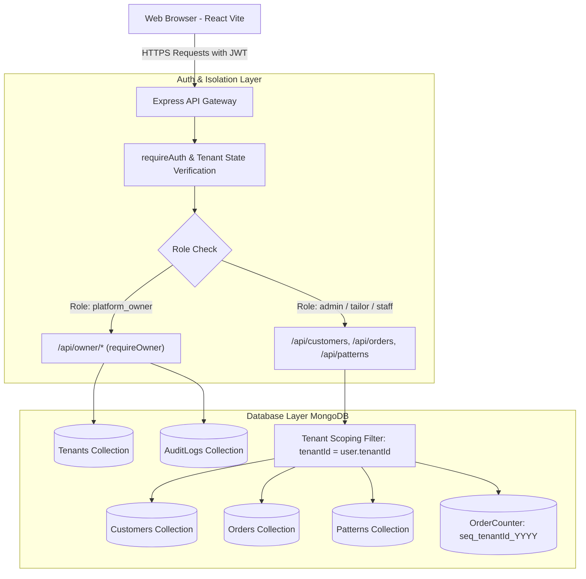

# Multi-Tenant SaaS Architecture & Operations Guide: Silai Master Tailor Management

This document provides a comprehensive operational guide and architectural reference for the multi-tenant SaaS transformation of the Tailor Management System.

---

## 1. System Architecture Overview

The system operates as a unified multi-tenant SaaS application with strict data isolation, role-based access control (RBAC), and centralized platform administration.



### Access Levels:
1. **Platform Owner (`platform_owner`):**
   - Accesses `/owner/login` and `/owner/*`.
   - Provisions, activates, deactivates, and audits tailoring business tenants.
   - Accesses aggregated platform statistics without mixing tenant business records.
2. **Tenant Administrator (`admin`):**
   - Accesses tailoring studio operations (`/`, `/orders`, `/customers`, `/settings/patterns`).
   - Scoped strictly to their own business `tenantId`.
   - Cannot view or manipulate data belonging to other tenants or platform owner endpoints.
3. **Tenant Staff (`tailor` / `staff`):**
   - Scoped to the tenant business account with tailored operational permissions.

---

## 2. Platform Owner Login

- **URL:** `http://localhost:5173/owner/login`
- **Default Bootstrap Credentials:**
  - **Email:** `owner@platform.com`
  - **Password:** `Owner@Pass2026!`
- **Access Portal:** Platform Administration Console
- **Session Management:** Dedicated JWT session with `role: "platform_owner"`. Ordinary users or unauthenticated visitors are prevented from accessing `/owner/*` routes by both frontend (`OwnerProtectedRoute`) and backend (`requireOwner`) guards.

---

## 3. How to Securely Create the First Platform Owner

The platform owner is created via an idempotent bootstrap CLI script rather than an insecure public registration endpoint:

```bash
cd server
node src/scripts/bootstrap_owner.js
```

### Environment Overrides:
You can customize the initial platform owner credentials in your `server/.env`:
```env
OWNER_EMAIL=owner@platform.com
OWNER_PASSWORD=Owner@Pass2026!
```
- The bootstrap script is **idempotent**: if an account with `role: "platform_owner"` already exists, it detects the existing administrator and exits safely without overwriting passwords or duplicating records.

---

## 4. How the Platform Owner Creates a New Tenant

1. Log into `/owner/login` and navigate to **Tenants Management** (`/owner/tenants`).
2. Click the **"Onboard Tenant"** button.
3. Enter tenant details:
   - **Business Name** (e.g., `Royal Tailors Studio`)
   - **Owner / Principal Name** (e.g., `Vikram Royal`)
   - **Email Address** (used as initial tenant administrator login)
   - **Mobile Number** (10 digits)
   - **Address, City, State, Pincode**
   - **Initial Administrator Password** (optional; defaults to a secure generated password)
4. On submit, the system atomically:
   - Generates a unique, collision-proof **Tenant Code** (e.g., `ROYAL-2418`).
   - Creates the `Tenant` record with `status: 'active'`.
   - Creates the initial tenant administrator `User` record associated with the new `tenantId`.
   - Seeds tenant-specific starter patterns (Shirt & Pant patterns).
   - Records an immutable audit log entry in `AuditLog`.
5. A modal displays initial onboarding credentials with a **"Copy Credentials"** action for delivery to the client.

---

## 5. How the Initial Tenant Administrator Receives Access

1. When created in step 4, the platform owner receives a credentials summary:
   - **Tailoring Business:** `Royal Tailors Studio`
   - **Tenant Code:** `ROYAL-2418`
   - **Portal URL:** `http://localhost:5173/login`
   - **Admin Email:** `vikram@royaltailors.com`
   - **Initial Password:** `<generated or chosen password>`
2. The tenant administrator navigates to `/login`, enters their email and password, and logs into their private tailoring dashboard.

---

## 6. How Each Tenant Logs In

- **Login URL:** `http://localhost:5173/login`
- **Validation:**
  - Authenticates credentials against `User`.
  - Checks if user account is active (`user.isActive`).
  - Checks if associated tenant business is active (`tenant.status === 'active'`).
  - If tenant is suspended (`inactive`), login is blocked with status code `403` and message: *"Your business account has been deactivated. Please contact platform support."*
- **Context Loading:** On login, the user's JWT payload attaches their `userId` and `tenantId`. The frontend dynamically brands the Header and Sidebar with the tenant's own `shopName` and `tenantCode`.

---

## 7. Storage & Isolation of Customers, Orders, Measurements & Patterns

### 1. Customers (`Customer` model)
- Every customer record contains a mandatory `tenantId: ObjectId` reference.
- Compound unique index: `{ tenantId: 1, mobileNumber: 1 }`. Multiple separate tailor businesses can have different customers with the same mobile number without conflicts.
- Queries, searches, and lookups filter strictly by `{ tenantId: req.user.tenantId }`.

### 2. Orders (`Order` model)
- Every order document contains `tenantId: ObjectId` and `customer: ObjectId`.
- Compound unique index: `{ tenantId: 1, orderNumber: 1 }`.
- Scoped atomic order number sequencing via `OrderCounter`: `ORD-YYYY-XXXXX` increments independently per tenant without sequence overlap or race conditions.
- Validation ensures that the selected customer belongs to the authenticated tenant.

### 3. Measurements
- Customer measurements (Shirt & Pant) are stored permanently in `Customer.latestMeasurements` scoped to the tenant.
- Each order captures an immutable snapshot of garment measurements (`order.shirt.measurements` and `order.pant.measurements`) so future edits to the customer profile never alter historical orders.

### 4. Shirt & Pant Patterns (`Pattern` model)
- Patterns are tenant-specific (`tenantId: ObjectId`).
- Compound index: `{ tenantId: 1, type: 1, name: 1 }`.
- Editing or deleting a pattern in Tenant A has zero effect on Tenant B.
- Starter patterns (Plain, Formal, Chex, Kurta Collar, etc.) are seeded automatically upon tenant creation.

---

## 8. Tenant Deactivation and Reactivation

### Deactivation Workflow:
1. Platform Owner clicks **"Suspend"** on any tenant row in `/owner/tenants` or `/owner/tenants/:id`.
2. A confirmation modal explains that the tenant's access will be suspended while preserving all data.
3. System updates `Tenant.status = 'inactive'`, records `deactivatedAt` and `deactivatedBy`, and logs the audit event.
4. **Immediate Access Revocation:** The central auth middleware (`requireAuth`) inspects the tenant's live database status on every API request. Any request using previously issued JWT tokens from suspended tenant staff is blocked immediately with `403 TENANT_INACTIVE`.
5. No customer, order, or measurement records are deleted.

### Reactivation Workflow:
1. Platform Owner clicks **"Reactivate Tenant"**.
2. Status updates to `active`, clearing `deactivatedAt`.
3. Tenant staff can immediately log in and access all existing historical records seamlessly.

---

## 9. Database Backup & Disaster Recovery

The project includes an integrated local backup system with automated cron support:
- **Location:** `server/backups/`
- **Endpoints:**
  - `GET /api/backups`: Lists backups and storage retention metrics.
  - `POST /api/backups/trigger`: Creates an immediate JSON snapshot of all collections (`tenants`, `users`, `customers`, `orders`, `patterns`, `ordercounters`, `auditlogs`).
  - `GET /api/backups/download/:filename`: Download backup locally.
  - `POST /api/backups/restore/:filename`: Restores database from a local snapshot.

To create an immediate database backup via script:
```bash
cd server
node -e "import('./src/services/backupService.js').then(m => m.createBackup({ triggeredBy: 'manual_cli' }))"
```

---

## 10. How to Migrate Existing Data Safely

If upgrading an existing single-tenant installation with pre-existing records:

1. Ensure MongoDB is running and `server/.env` is configured.
2. Execute the migration script:
   ```bash
   cd server
   node src/scripts/migrate_to_multitenant.js
   ```
3. What the migration script does:
   - Creates or links the primary tenant (`Silai Master Tailor Studio`, code `SILAI-MASTER`).
   - Safely removes legacy single-tenant unique indexes (`orderNumber_1`, `mobileNumber_1`).
   - Assigns existing users, customers, orders, and patterns to the primary tenant ID.
   - Synchronizes new compound multi-tenant indexes.
   - Validates that zero unassigned orphan records exist.

---

## 11. Environment Configuration

### `server/.env`:
```env
PORT=5000
MONGODB_URI=mongodb://127.0.0.1:27017/tailor_management
JWT_SECRET=super_secret_tailor_management_key_2026_xyz
CLIENT_URL=http://localhost:5173
OWNER_EMAIL=owner@platform.com
OWNER_PASSWORD=Owner@Pass2026!
NODE_ENV=development
```

### `client/.env`:
```env
VITE_API_URL=/api
```

---

## 12. Running the Application

### Start Backend:
```bash
cd server
npm install
npm start
```
*Backend runs at `http://localhost:5000` (Health check: `http://localhost:5000/api/health`)*

### Start Frontend:
```bash
cd client
npm install
npm run dev
```
*Frontend runs at `http://localhost:5173`*

---

## 13. How to Test Tenant Isolation

Run the automated multi-tenant backend verification suite:
```bash
cd server
node src/scripts/verify_multitenant_backend.js
```

This automated suite tests and verifies:
1. Platform owner RBAC (tenant administrators cannot call `/api/owner/*`).
2. New tenant onboarding and starter pattern generation.
3. Cross-tenant customer isolation (Tenant A search cannot find Tenant B's customer).
4. Direct ID tampering (Tenant A querying Tenant B's customer or order by MongoDB `_id` receives `404 Not Found`).
5. Cross-tenant order customer binding rejection (Tenant A cannot attach Tenant B's customer to an order).
6. Real-time deactivation enforcement (suspended tenant API access rejected with `403`).
7. Reactivation data preservation.
8. Audit log recording.

---

## 14. Production Deployment Guidelines

1. **Database:** Use MongoDB Atlas or a clustered MongoDB replica set.
2. **Environment Secrets:** Replace `JWT_SECRET` and `OWNER_PASSWORD` with cryptographically random 64-character strings.
3. **HTTPS / SSL:** Terminate SSL/TLS at your reverse proxy (Nginx, Cloudflare, or AWS ALB).
4. **CORS:** Restrict `CLIENT_URL` to your production frontend domain (e.g., `https://app.yourdomain.com`).
5. **Static Assets:** Build the client using `npm run build` in `client` and serve via CDN or Express static middleware.

---

## 15. Known Limitations & Manual Steps

1. **Email Service Integration:** The onboarding flow currently returns initial passwords directly in the UI and response payloads. If SMTP/SES email delivery is desired in the future, integrate Nodemailer with an email template provider.
2. **Custom Domain Mapping:** Tenants currently share the primary domain and distinguish sessions via JWT tenant identity. Subdomain routing (e.g., `tenantcode.yourdomain.com`) can be configured via DNS wildcard and reverse proxy header forwarding if required.
